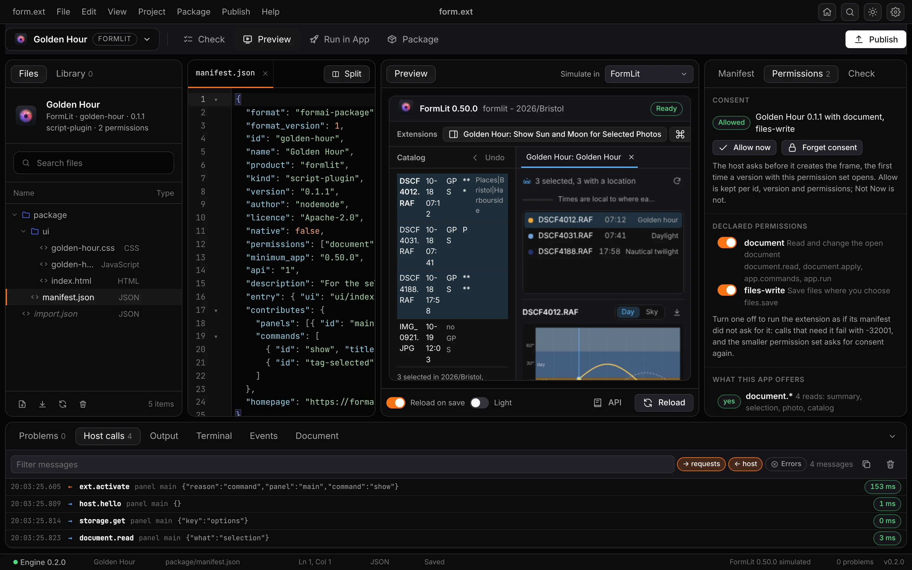
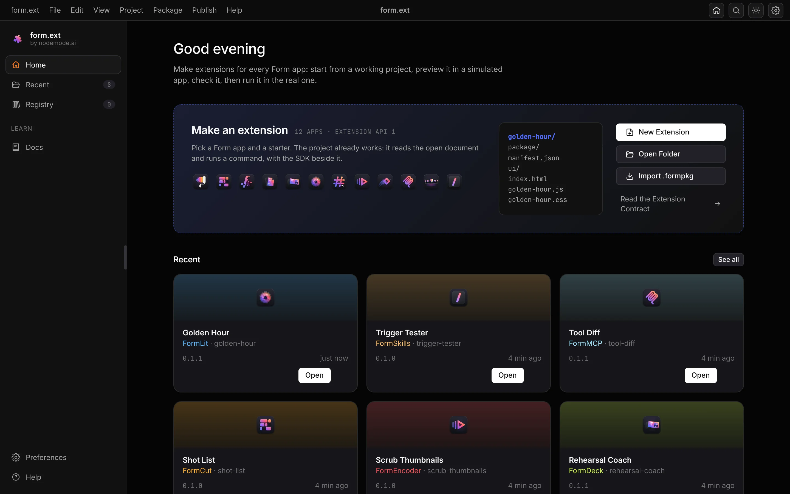
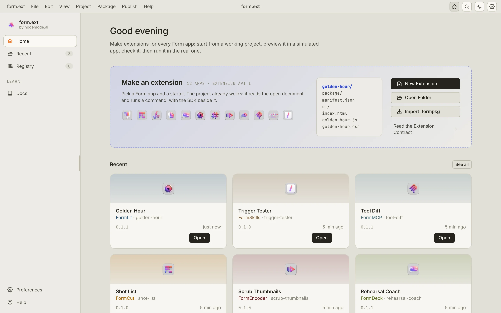
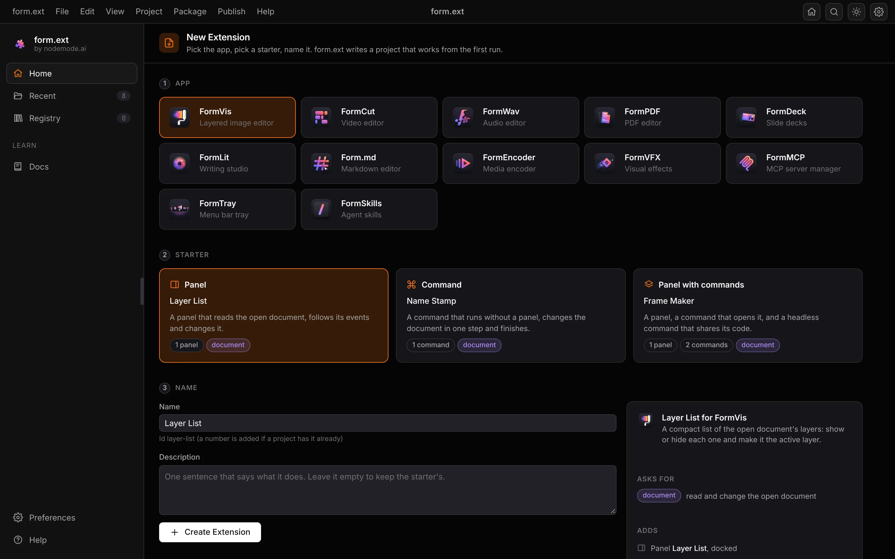
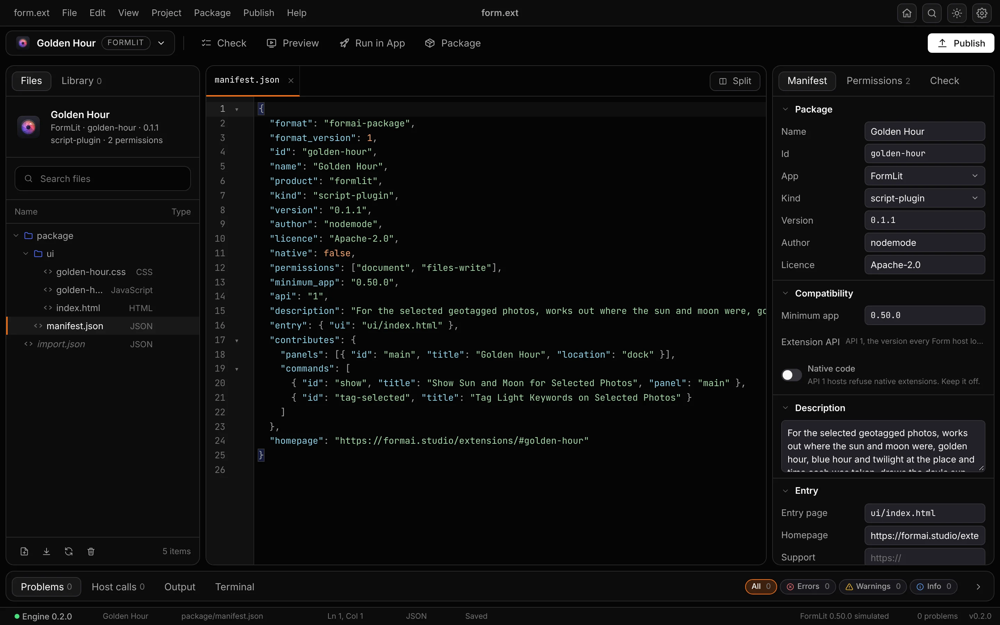
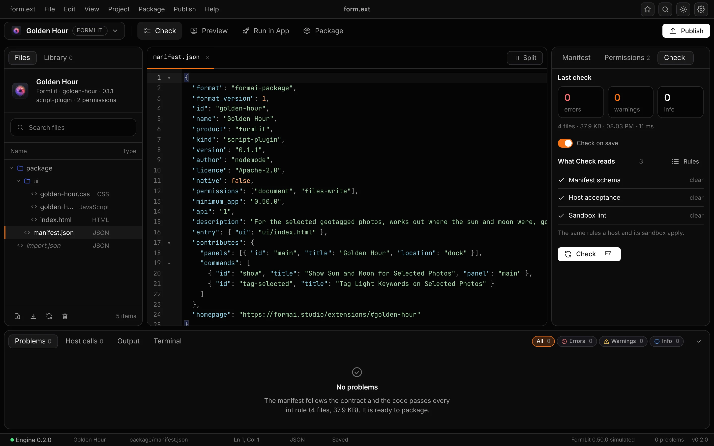
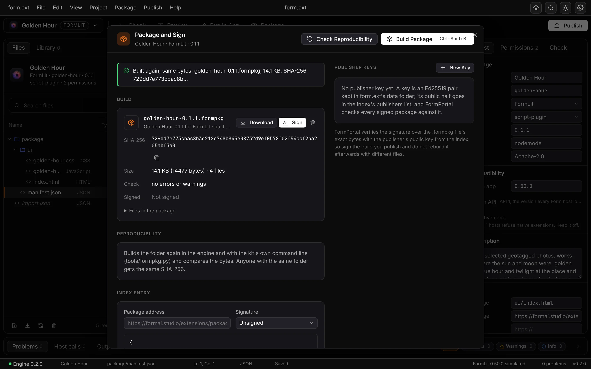
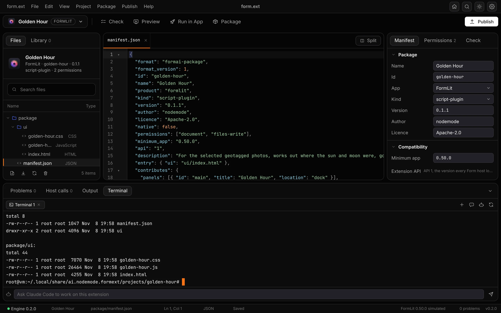
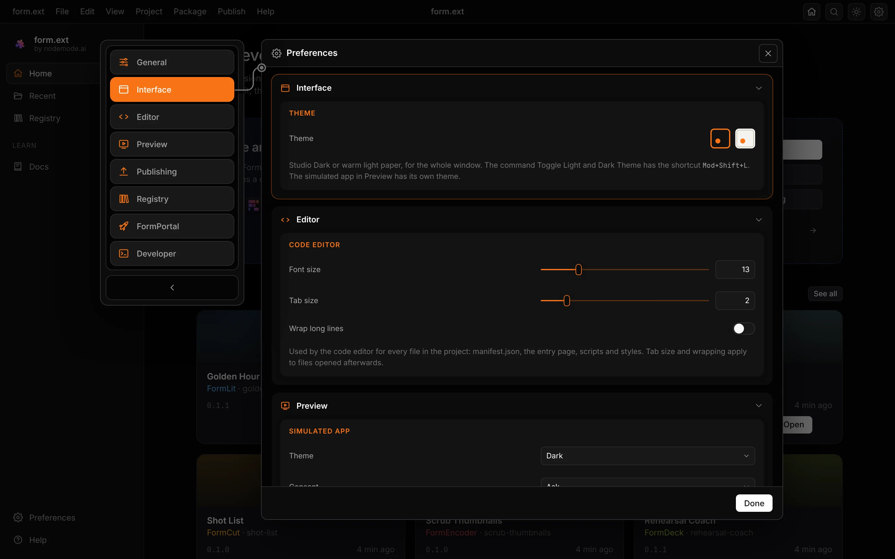

<p align="center">
  <picture>
    <source media="(prefers-color-scheme: dark)" srcset="assets/app-icon/formext-256.png">
    
  </picture>
</p>

<h1 align="center">form.ext</h1>

<p align="center">
  <b>The extension studio; make extensions for every Form app.</b><br>
  Start from a working project, try it in a simulated app, check it against the contract,<br>
  then run it in the real app, sign it and publish it. Free and open source.
</p>

<p align="center">
  
  
  
  
  
  
  
</p>

<p align="center">
  <a href="demo/index.html"><b>Try the browser demo</b></a> ·
  <a href="docs/MANUAL.md">Manual</a> ·
  <a href="contract/CONTRACT.md">Extension Contract</a> ·
  <a href="#run-it-from-source">Run it from source</a>
</p>

<br>

<p align="center">
  
  <br><sub>The Studio: Golden Hour, a FormLit extension, previewed in a simulated FormLit beside its manifest, with consent, permissions and every host call logged.</sub>
</p>

<p align="center">
  <a href="#features">Features</a> · <a href="#everything-in-the-box">In the box</a> · <a href="#built-for-agents">Agents</a> · <a href="#under-the-hood">Under the hood</a> · <a href="#demo">Demo</a> · <a href="#run-it-from-source">Run from source</a>
</p>

<br>

<table>
  <tr>
    <td width="25%" valign="top"><h3>Every Form app</h3>Starters for all twelve hosts, each a panel, a command or both, that read the app's document and run a real command from day one.</td>
    <td width="25%" valign="top"><h3>Try before the app</h3>Preview runs the extension in a simulated host for its app, with the contract's own bridge, a realistic document, events and consent.</td>
    <td width="25%" valign="top"><h3>The contract, checked</h3>Check reads the manifest and the code the way a host and its sandbox will, and says what to change, line by line.</td>
    <td width="25%" valign="top"><h3>Agent-ready</h3>The window, a command line and an MCP server share one engine, so Claude Code, Codex and Cursor make extensions the way a person does.</td>
  </tr>
</table>

<br>

## Features

<table>
  <tr>
    <td width="50%" valign="top">
      
      <br><sub>Home, in Studio Dark.</sub>
    </td>
    <td width="50%" valign="top">
      
      <br><sub>Home, in warm light paper.</sub>
    </td>
  </tr>
  <tr>
    <td colspan="2" valign="top">
      <h3>Home, one click away</h3>
      The Home button in the top bar (Mod+Shift+H) and the sidebar's Home, Recent, Registry and Docs open the Start page from anywhere: make an extension for any of the twelve apps, open a folder, import a <code>.formpkg</code>, or pick up a recent project. Light and dark follow the theme button or Mod+Shift+L.
    </td>
  </tr>
  <tr>
    <td width="50%" valign="top">
      
      <br><sub>Pick the app, pick a starter, name it.</sub>
      <h3>New extension in one step</h3>
      Twelve apps, three starters each. The project already works: it reads the open document and runs a command, with the SDK beside it.
    </td>
    <td width="50%" valign="top">
      
      <br><sub>The manifest form and the JSON stay in sync, both ways.</sub>
      <h3>The Studio, with the manifest in view</h3>
      One window per project: Files and Library on the left, a CodeMirror editor with Split for Preview in the middle, the Manifest, Permissions and Check inspector on the right, and Problems, Host calls, Output and Terminal below. The toolbar runs Check, Preview, Run in App and Package; Publish is beside it.
    </td>
  </tr>
  <tr>
    <td width="50%" valign="top">
      
      <br><sub>Golden Hour checks clean: ready to package.</sub>
      <h3>Check against the contract</h3>
      Schema and package rules, what an API 1 host accepts, and lint for what the sandbox blocks: inline script, direct network use, eval, browser storage, missing files, and permissions used but not declared. Check on save, or F7; click a problem to open the line.
    </td>
    <td width="50%" valign="top">
      
      <br><sub>A deterministic build, built again to the same bytes.</sub>
      <h3>Package, reproduce, sign</h3>
      The kit's deterministic `.formpkg`, its SHA-256 and size, a byte-for-byte reproducibility check, and Ed25519 publisher keys kept in form.ext's data folder.
    </td>
  </tr>
  <tr>
    <td width="50%" valign="top">
      
      <br><sub>Mod+J opens the Terminal in the project's folder.</sub>
      <h3>Terminal and Claude Code</h3>
      A real shell in the open project's folder, a Claude Code tab with formext and formMCP already connected, and a Chat tab on <code>claude -p</code> with tool chips and permission cards. Ask Claude Code to work on this extension from the field below.
    </td>
    <td width="50%" valign="top">
      
      <br><sub>Preferences (Mod+,): General, Interface, Editor, Preview, Publishing, Registry, FormPortal, Developer.</sub>
      <h3>Preferences</h3>
      The author and licence for new projects, the theme, the editor, the simulated app's theme and consent, publishing, the registry address, FormPortal's folder and developer switches, kept in form.ext's data folder.
    </td>
  </tr>
  <tr>
    <td width="50%" valign="top">
      <h3>Run in the real app</h3>
      Writes the app's `dev.json` in FormPortal's folder so the installed app loads the extension live, shows which Form apps are installed, and opens them.
    </td>
    <td width="50%" valign="top">
      <h3>Library and publishing</h3>
      Import or inspect any `.formpkg`, compare two builds, and start from form.ext-registry's verified extensions, read from its signed index. Publish writes the extensions index entry and a submission folder, sends the package to FormPortal, or submits the project to the registry: its layout, its own checks, and the commands for the pull request.
    </td>
  </tr>
</table>

## Everything in the box

<table>
  <tr>
    <td width="33%" valign="top"><h4>In the window</h4>Home · New · Studio (files, code, manifest, Check, Preview, Library) · Terminal and Claude Code · Run in App · Package · Publish · Docs · Preferences</td>
    <td width="33%" valign="top"><h4>27 MCP tools</h4>status · docs · templates · new · read · write · manifest · validate · preview · package · sign · verify · run_in_app · publish · submit and the rest</td>
    <td width="33%" valign="top"><h4>Twelve hosts</h4>FormVis · FormCut · FormWav · FormPDF · FormDeck · FormLit · form.md · FormEncoder · FormVFX · FormMCP · FormTray · FormSkills</td>
  </tr>
</table>

## Built for agents

The window, the command line and the MCP server call one engine, so an agent and a person see the same projects, and every change an agent makes appears in the open window at once.

```sh
./formext cli new "Beat Board" --app formwav --starter panel   # a working project from a starter
./formext cli validate beat-board                              # Check, in the same words as the window
./formext cli package beat-board                               # the deterministic .formpkg
./formext mcp                                                  # MCP server on stdio
```

`.mcp.json`, `.codex/config.toml` and `.cursor/mcp.json` are already wired in this repo, with the `formext-harness` skill for making extensions and `formext-skillset` for changing form.ext. See [`AGENTS.md`](AGENTS.md).

### Agents

```sh
./formext claude            # Claude Code in this repo, already connected to formext (and formMCP when found)
./formext agents install    # the same MCP servers and skills for your account: Claude Code, Codex and Cursor
./formext agents status     # what is installed, which servers, how many skills, whether formMCP is found
./formext agents sync       # regenerate the tool reference and mirror .claude/skills to .agents/skills
./formext agents sync --check   # exits 1 on any drift, for CI
```

Two MCP servers are registered: `formext` (this studio) and `formmcp`, the Form family hub that reaches every installed Form app's own tools. formMCP is a separate app: when it is not installed, `formmcp` shows as failed or unavailable in your agent and everything else works; install it with FormPortal and run `./formext agents install` again. The skills include `formext-harness` (the build loop), `formext-hosts` (what an extension can do in each of the twelve apps, which host skill explains the app, how to test live) and the host skills copied from the apps themselves, recorded with their source commits in [`.claude/skills/HOSTS.md`](.claude/skills/HOSTS.md). With these, "make a FormWav extension that does X" can be built, checked, previewed, packaged and run in the app by Claude Code, Codex or Cursor.

### Terminal

The Studio's bottom panel has a Terminal tab (View, Terminal, or Mod+J) next to Problems, Host calls and Output. The engine owns the sessions: a real shell in the open project's folder, an xterm view, a Claude Code tab that starts `claude` with formext and formMCP connected and the skills available, and a Chat tab that runs `claude -p` with streamed output, tool chips and permission cards. If Claude Code is not installed the tab says so and shows the install command. The routes answer on 127.0.0.1 only and refuse any other Host or Origin.

## Under the hood

- **One contract:** the Form Extension Contract kit is vendored unchanged in `contract/`: the spec, schemas, SDK, host bridge, the Python resolver and `formpkg`. Preview runs the kit's own bridge; Package builds with the kit's own rules.
- **One engine:** a FastAPI engine on 127.0.0.1:8640 owns the projects, checks, builds, keys and FormPortal's folder; the interface, the command line and the MCP server are thin layers over its routes.
- **Built from a registry:** each pane registers itself, and the shell lays out every pane before the first paint, so nothing moves when it opens.
- **The SDK:** `sdk/` is the publishable `@formai/ext` package (`formext.ts` with built `.js` and `.d.ts`).

## Demo

[`demo/index.html`](demo/index.html) runs the real interface offline in any browser, by double-click or from any static server, with an engine written for the page: Golden Hour open, Mail Merge and Rating Desk beside it, every pane usable, the first-party extensions previewed live, real deterministic packages and Ed25519 signatures in the browser. See [`demo/README.md`](demo/README.md).

## Run it from source

**Requires:** Node 20.19 or newer, Python 3.12, git. Rust stable and the Tauri prerequisites only for the desktop window.

```sh
git clone git@github.com:nodemode-dev/form.ext.git
cd form.ext
./formext_oc_install        # engine venv and interface packages
./formext           # interface at http://localhost:5640, engine on 127.0.0.1:8640
```

`./formext_oc_install` is the install, `./formext` is the boot, and `./build_app` makes the desktop app start to finish and logs to `build_app.log`. On Windows use `formext_oc_install.bat`, `formext.bat` and `build_app.bat`.

Ports: interface 5640 (Vite, localhost only), engine 8640 (`FORMEXT_PORT`). `./formext serve` serves a production build from the engine alone, `./formext desktop dev` opens the desktop window, and `./formext doctor` checks the toolchain. `FORMEXT_HOME` moves the data folder.

> [!IMPORTANT]
> **Status:** in development. Run in App and Send to FormPortal need FormPortal and the Form apps installed on the same computer.

**Contributing:** branch from `main`, keep changes to source here, and leave packaging and releases to FormCompiler. See [`AGENTS.md`](AGENTS.md) and [`CLAUDE.md`](CLAUDE.md).

## Repository

| Path | What it is |
|---|---|
| `frontend/` | the interface (vanilla TypeScript and Vite): the shell and one folder per pane |
| `backend/` | the FastAPI engine, the command line and the MCP server |
| `src-tauri/` | the Tauri 2 shell |
| `contract/` | the Form Extension Contract kit, vendored unchanged |
| `templates/` | the starters, three for each of the twelve apps |
| `sdk/` | `@formai/ext`, the extension SDK package |
| `docs/` | the manual and each app's extension API page |
| `demo/` | the offline browser demo |

Docs: [`docs/MANUAL.md`](docs/MANUAL.md), [`.docs/wiki`](.docs/wiki) · Agents: [`CLAUDE.md`](CLAUDE.md), [`AGENTS.md`](AGENTS.md) · Changes: [`CHANGELOG.md`](CHANGELOG.md)

---

## Maintainers

| Maintainer | Role |
|---|---|
| [@nodemode-ai](https://github.com/nodemode-ai) | Owner |
| [@gbarnai](https://github.com/gbarnai) | Co-owner |

## License

form.ext is licensed under the GNU General Public License v3.0 ([`LICENSE`](LICENSE), SPDX `GPL-3.0-only`). Copyright 2026 NodeAgentc, Inc. The Form Extension Contract kit (`contract/`), the `@formai/ext` SDK (`sdk/`) and the starters (`templates/`) stay under the Apache License 2.0 (each folder's own `LICENSE`, or the kit's), so the extensions you make with form.ext are yours to license as you choose. Third-party notices: [`NOTICE.md`](NOTICE.md).

<sub>Screenshots show form.ext 0.2.0 from source (interface and engine) at 1440 by 900; the extensions in them are the Form family's first-party examples, imported from their `.formpkg` files.</sub>
